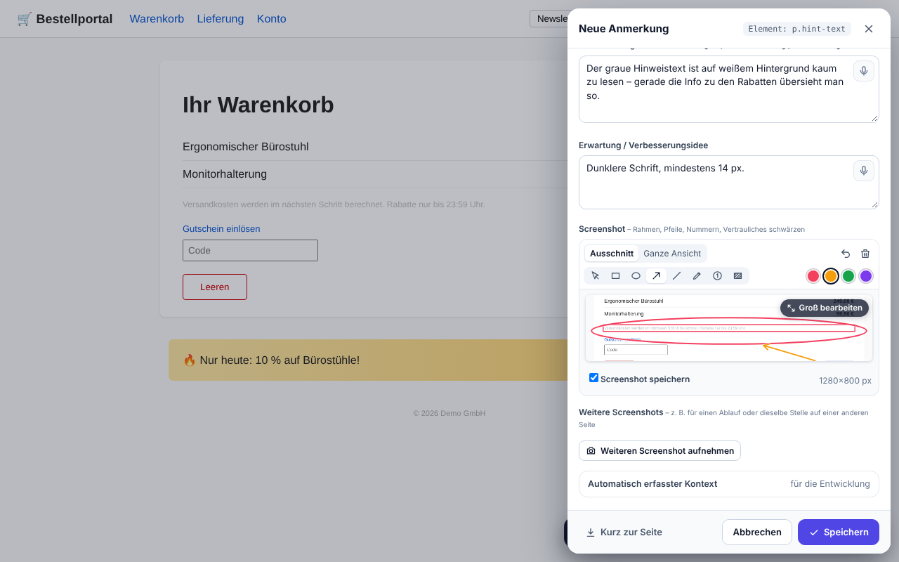
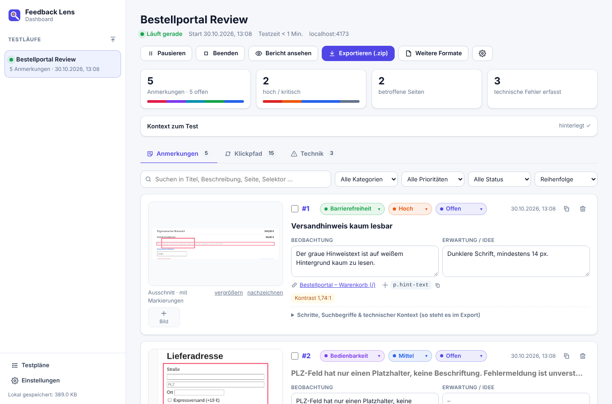
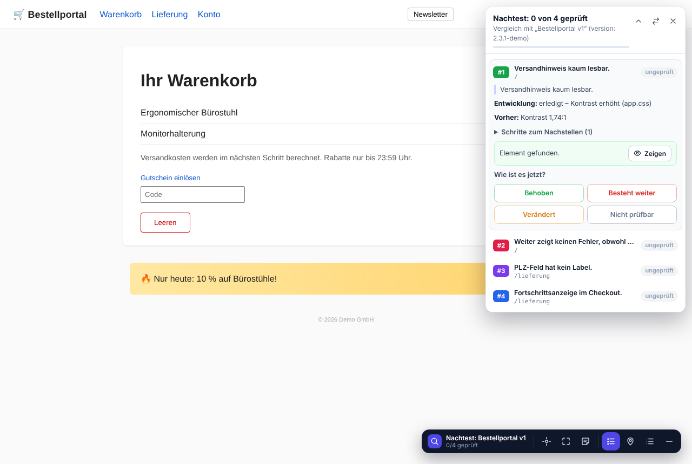

# Feedback Lens

**Webanwendungen durchklicken, Verbesserungspotenzial direkt am Element anmerken – und alles als sauberes Paket an die Entwicklung übergeben, die es mit Claude Code abarbeitet.**

Feedback Lens ist eine Browser-Erweiterung für Chrome, Edge, Brave & Co. Du startest auf der zu testenden Webanwendung einen *Testlauf*, klickst dich ganz normal durch und markierst alles, was dir auffällt: ein Element, einen Bereich oder die ganze Seite. Zu jeder Anmerkung speichert Feedback Lens automatisch einen Screenshot (mit roter Markierung), die Schritte bis dahin und genau die technischen Details, mit denen ein Entwickler – oder Claude Code – die Stelle im Code schnell findet.

- **Keine Abhängigkeiten:** reines JavaScript, kein Build-Schritt, keine Bibliotheken, kein Konto, kein Server.
- **Alles lokal:** Die Daten bleiben im Browser. Die Erweiterung sendet nichts ins Netz – der Export ist eine ZIP-Datei auf deiner Festplatte.

| Anmerken direkt am Element | Übersicht im Dashboard |
|---|---|
|  |  |

---

## Der Ablauf

```
Tester:in                         Entwickler:in                      Claude Code
─────────                         ─────────────                      ───────────
Testlauf starten                  ZIP entpacken, Ordner ins           liest README.md, öffnet je
durchklicken & anmerken    ──▶    Repository legen (feedback/)  ──▶   Anmerkung Screenshots, sucht
„Beenden & exportieren“           Claude Code beauftragen             den Code, setzt um, hält das
→ feedback-….zip weitergeben                                          Ergebnis in der README fest
        ▲                                                                       │
        │  Nachtest in der neuen Version: behoben? besteht weiter?             │
        └──────────────── (optional: README mit den Ergebnissen einlesen) ◀────┘
```

---

## Installation

> Voraussetzung: ein Chromium-Browser ab Version 116 (Chrome, Edge, Brave, Opera, Vivaldi, Arc).

1. Die Datei `feedback-lens-1.13.0.zip` entpacken.
2. Im Browser `chrome://extensions` öffnen (Edge: `edge://extensions`).
3. Oben rechts den **Entwicklermodus** einschalten.
4. **„Entpackte Erweiterung laden“** klicken und den entpackten Ordner `extension` auswählen (der Ordner, in dem `manifest.json` liegt).
5. Über das Puzzle-Symbol in der Browserleiste Feedback Lens **anpinnen**.

Beim Laden zeigt der Browser den Hinweis, dass die Erweiterung „alle Daten auf allen Websites lesen und ändern“ darf. Das ist nötig, damit sie auf *jeder* Webanwendung, die du testen willst, Screenshots machen und die Leiste einblenden kann. Aktiv wird sie aber **nur auf den Domains eines laufenden Testlaufs** – auf allen anderen Seiten lädt sie nichts, außer du löst dort ausdrücklich eine [Schnell-Anmerkung](#schnell-anmerkung-eine-beobachtung-direkt-in-den-chat) aus (dann nur in diesem Tab).

Für lokale Dateien (`file://…`) zusätzlich in den Details der Erweiterung **„Zugriff auf Datei-URLs zulassen“** aktivieren.

---

## Testen

1. **Anwendung öffnen**, z. B. `https://staging.example.com`, und ggf. anmelden.
2. **Feedback-Lens-Symbol** klicken → Namen vergeben → optional unter „Kontext zum Test“ notieren, worum es geht (z. B. *„Kundenverwaltung, Staging, Build 2.3.1. Fokus: neuen Kunden anlegen.“*) → **„Testlauf auf dieser Seite starten“**.
3. Unten rechts erscheint die **Feedback-Lens-Leiste** (verschiebbar, minimierbar).
4. Normal durch die Anwendung klicken. Wenn dir etwas auffällt:
   - **Element markieren** (Fadenkreuz oder `Alt+Shift+E`) → Element anklicken (mit `↑` zum umgebenden Element),
   - **Bereich markieren** (Rahmen oder `Alt+Shift+D`) → Rechteck aufziehen,
   - **Seiten-Notiz** (Notiz-Symbol oder `Alt+Shift+S`).
5. Im Dialog Kategorie und Priorität wählen, **beschreiben, was dich stört**, und optional, was du erwartet hättest. Den Screenshot kannst du bearbeiten (siehe unten). `Strg+Enter` speichert.
6. Zum Schluss im Popup **„Beenden & exportieren“** – das Paket wird heruntergeladen. Ohne Export geht **„Beenden“** (exportieren und fortsetzen lässt sich später im Dashboard). Für eine Unterbrechung gibt es **„Pausieren“**: Erfassung und Testzeit ruhen, und das Popup zeigt den Testlauf oben mit **„Fortsetzen“** an.

**Screenshot bearbeiten**

- **„Groß bearbeiten“** (Knopf auf der Vorschau) öffnet den Screenshot fensterfüllend – mit Ausschnitt und ganzer Ansicht. `Esc` oder „Fertig“ führt zurück in den Dialog.
- **Formen:** **Rahmen** (voreingestellt), **Kreis**, **Pfeil** und **Linie** aufziehen – mit gedrückter Umschalttaste (⇧) quadratisch, rund bzw. gerade (waagerecht, senkrecht, 45°). Dazu **Freihand**. Vier Farben (Rot, Orange, Grün, Violett) stehen neben den Werkzeugen.
- **Auswählen** (Pfeil-Werkzeug): eine Markierung anklicken, um sie zu verschieben, umzufärben (Farbfeld klicken) oder mit dem roten **×** bzw. `Entf` zu entfernen. `Strg+Z` nimmt den letzten Schritt zurück – auch ein Verschieben.
- **Nummern:** Jeder Klick ins Bild setzt die nächste Nummer ①②③ – z. B. für die Reihenfolge von Schritten.
- **Notizen zu den Nummern:** Sobald es Nummern gibt, erscheint unter dem Screenshot (und im großen Editor rechts neben dem Bild) ein Feld je Nummer – bei eingezeichneten Klicks steht schon dabei, worauf geklickt wurde. Die Notiz gehört zum Kreis: Entfernst du ② (×), wird aus ③ eine ②, und der Text wandert mit; „Rückgängig“ holt Nummer und Text zurück. Diktieren geht auch hier.
- **Letzte Klicks einzeichnen:** zeigt, wo du auf dieser Seite zuletzt geklickt hast, nummeriert in der Reihenfolge (bis zu 9). Im großen Editor lassen sich einzelne Klicks weglassen. Die Einstellung merkt sich Feedback Lens für die nächste Anmerkung.
- **Schwärzen:** Rechteck über Vertrauliches ziehen. Gespeichert wird nur das geschwärzte Bild – in Ausschnitt *und* ganzer Ansicht.
- **Später im Dashboard:** „nachzeichnen“ unter dem Vorschaubild (oder „Nachzeichnen“ in der Großansicht) ergänzt Formen, Nummern, Klicks und geschwärzte Stellen. Bereits Gespeichertes lässt sich dort nicht mehr entfernen – Feedback Lens bewahrt bewusst nur das fertige Bild auf, damit Geschwärztes nirgends im Original übrig bleibt.
- Im Export stehen die Nummern mit deinen Notizen direkt unter der Beobachtung („Zu den Nummern im Screenshot“), z. B. „① Klick auf ‚Weiter‘ (`button#next`, 14:03:12) – danach passiert 3 s nichts“ – so kann Claude Code Bild, Element im Code und Erklärung zusammenbringen. Im Dashboard lassen sich die Notizen an jeder Anmerkung nachträglich ändern.

**Mehrere Screenshots**

Für einen Ablauf („erst so, nach dem Klick so“), einen Zustand (Menü offen, Fehlermeldung) oder dieselbe Stelle auf einer anderen Seite:

1. Im Dialog **„Weiteren Screenshot aufnehmen“** – der Dialog geht kurz zur Seite, oben erscheint ein Hinweis.
2. Die Seite vorbereiten: scrollen, klicken, Menü öffnen, auch auf eine **andere Seite** wechseln.
3. In der Leiste **Element**, **Bereich** oder **Seite** wählen (oder per Tastenkürzel – wichtig für Hover-Zustände) bzw. im Hinweis „Sichtbaren Bereich aufnehmen“. Danach geht der Dialog mit dem neuen Bild wieder auf.

Jedes weitere Bild („Bild 2“, „Bild 3“ …, bis zu 8 Screenshots je Anmerkung) bekommt eine **Beschriftung**, lässt sich **umsortieren**, **entfernen** und – Klick auf die Vorschau – groß **bearbeiten** (Formen, Nummern mit Notizen, Schwärzen). Bei „Zu #n hinzufügen“ wird der Screenshot als weiteres Bild an #n angehängt (abwählbar). Im **Dashboard** lassen sich unter jeder Anmerkung Bilder **einfügen** (`Strg+V`, Datei ziehen oder wählen – z. B. ein Handy-Screenshot), beschriften, verschieben, nachzeichnen und entfernen. Im Export stehen sie mit Beschriftung, Seite und ihren Nummern direkt unter dem jeweiligen Bild.

**Kurz zur Seite**

Mitten im Schreiben noch etwas nachsehen? **„Kurz zur Seite“** unten im Dialog schließt ihn, ohne etwas zu verlieren – die Anwendung ist wieder bedienbar. In der Leiste erscheint **„Entwurf“**; ein Klick darauf öffnet den Dialog wieder mit Text, Kategorie, Screenshot und Markierungen. Der Entwurf bleibt gespeichert, auch beim Neuladen, auf anderen Seiten und in anderen Tabs des Testlaufs (bis zu 5 Entwürfe; bei mehreren zeigt die Leiste eine Auswahl). Ein **Klick neben den Dialog** wirkt genauso – verworfen wird nur über „Abbrechen“, × oder `Esc` (bei Eingaben erst nach einer Rückfrage). Verlässt du die Seite oder pausierst bzw. beendest du den Testlauf, während ein ausgefüllter Dialog offen ist, sichert Feedback Lens ihn ebenfalls als Entwurf.

**Tipps**

- *Aufgeklappte Menüs, Tooltips, Hover-Zustände:* die **Tastenkürzel** nutzen – ein Klick auf die Leiste würde das Menü oft schließen.
- *Je konkreter, desto besser:* Was wolltest du tun? Was ist passiert? Warum ist das ein Problem?
- *Fehler erst auslösen, dann anmerken:* Klick auf den Button, der nicht funktioniert, Formular absenden usw. – dann das Element markieren. Feedback Lens ordnet zu, was nach diesem Klick passiert ist (Serverfehler, Konsolenmeldungen, angezeigte Fehlermeldungen, Seitenwechsel).
- *App-Version:* Unter „Kontext zum Test“ lässt sich Version/Build/Commit angeben (wird sonst, falls vorhanden, aus der Seite gelesen). So kann die Entwicklung prüfen, ob der Code zum getesteten Stand passt.
- *Lieber sprechen als tippen?* Mikrofon-Symbol im Textfeld (siehe [Diktat](#diktat)) – oder die Diktierfunktion des Betriebssystems (Windows: `Win+H`, macOS: Fn-Taste zweimal).
- *Mehrere Domains* (z. B. separater Login): im Popup „… zum Testlauf hinzufügen“.
- *Schon angemerkt?* Markierst du ein Element (oder einen fast gleichen Bereich), zu dem es in diesem Testlauf schon eine Anmerkung gibt, zeigt der Dialog sie an. Mit **„Zu #n hinzufügen“** wird dein Text dort als Nachtrag angehängt (der Screenshot als weiteres Bild), statt eine doppelte Anmerkung anzulegen; „Neue Anmerkung“ bleibt möglich, wenn es ein anderes Problem ist. Im Nachtest weist der Dialog auf frühere Anmerkungen an derselben Stelle hin („Zur Nachtest-Liste“).
- *Nacharbeiten:* Im **Dashboard** lassen sich Texte, Kategorie, Priorität und Status jeder Anmerkung noch ändern, bevor du exportierst.
- *Sofort teilen:* **„Speichern & kopieren“** (Knopf mit dem Kopier-Symbol neben „Speichern“) speichert die Anmerkung wie gewohnt und legt sie zusätzlich mit Screenshot in die Zwischenablage – siehe [Schnell-Anmerkung](#schnell-anmerkung-eine-beobachtung-direkt-in-den-chat).

| Kürzel | Aktion |
|---|---|
| `Alt+Shift+E` | Element markieren (außerhalb eines Testlaufs: [Schnell-Anmerkung](#schnell-anmerkung-eine-beobachtung-direkt-in-den-chat)) |
| `Alt+Shift+D` | Bereich markieren (ebenso) |
| `Alt+Shift+S` | Notiz zur ganzen Seite (ebenso) |
| `Alt+Shift+F` | Feedback-Lens-Menü öffnen |
| `↑` / `↓` / `Enter` / `Esc` | Während der Auswahl: umgebendes/inneres Element, übernehmen, abbrechen |

Ändern unter `chrome://extensions/shortcuts` (auf dem Mac entspricht `Alt` der Wahltaste ⌥).

---

## Schnell-Anmerkung: eine Beobachtung direkt in den Chat

Manchmal reicht eine einzelne Beobachtung, ohne Testlauf und Paket – etwa um sie direkt in Claude oder ChatGPT einzufügen und dort zu besprechen.

1. Auf einer beliebigen Seite **`Alt+Shift+E`** (Element), **`Alt+Shift+D`** (Bereich) oder **`Alt+Shift+S`** (ganze Seite) drücken – oder im Popup unter **„Schnell-Anmerkung“** Element, Bereich oder Seite wählen. (Gehört die Seite zum laufenden Testlauf, wird es eine normale Anmerkung.)
2. Markieren, kurz beschreiben, bei Bedarf im Screenshot zeichnen oder schwärzen.
3. **„Kopieren“** – Text und Screenshot liegen in der Zwischenablage. Im Chat mit `Strg+V` (Mac: `⌘V`) einfügen.

Der Text ist kurz und enthält, womit sich die Stelle im Code finden lässt: Titel, Seite mit Adresse, Kategorie und Priorität, Beobachtung, Erwartung, Notizen zu den Nummern im Screenshot, betroffenes Element (Selektor, sichtbarer Text, Test-Attribute, Kontrast, Barrierefreiheits-Hinweise), angezeigte Meldungen und Browser/Fenstergröße. Kopiert wird die im Dialog gewählte Ansicht des Screenshots (Ausschnitt oder ganze Ansicht).

**Für wen kopiert wird**, legt das Feld **„Für“** im Dialog fest; den Standard bestimmst du im Dashboard unter *Einstellungen → Schnell-Anmerkung & Kopieren*:

| Ziel | Inhalt der Zwischenablage |
|---|---|
| **Claude / ChatGPT** (Standard) | Markdown-Text und Screenshot (PNG) |
| **Teams / Outlook / Word** | formatierter Text mit dem Screenshot im Text |
| **Ticket / E-Mail** | schlichter Text ohne Markdown und Screenshot |

Ob ein einziges Einfügen Text *und* Bild übernimmt, entscheidet die Anwendung, in die du einfügst. Kommt nur eines an, nach dem Kopieren **„Nur Text“** bzw. **„Nur Bild“** wählen und die Teile nacheinander einfügen.

Gespeichert wird bei einer Schnell-Anmerkung nichts. Ohne Testlauf zeichnet Feedback Lens vorher nichts auf: Konsolenfehler, fehlgeschlagene Anfragen und Schritte zum Nachstellen gibt es nur im Testlauf. Die Erweiterung wird nur in dem Tab aktiv, in dem du die Schnell-Anmerkung auslöst, und nur bis du kopiert („Fertig“) oder abgebrochen hast.

---

## Testplan: gezielt prüfen, was dran ist

Ein Testplan legt vorher fest, *was* geprüft werden soll. Beim Testen hakst du jeden Prüfpunkt ab – der Export zeigt dann nicht nur Probleme, sondern auch, was getestet wurde und funktioniert.

1. **Anlegen:** Dashboard → **Testpläne** → „Neuer Testplan“, oder eine `testplan.md` **importieren** (z. B. von der Entwicklung oder aus einem Export-Paket). Format:

   ```markdown
   # Testplan: Checkout 2.4
   Domains: https://staging.shop.de

   ## Bestellung
   - [ ] Als Gast bestellen
     - Start: /warenkorb
     - Erwartung: Bestätigung mit Bestellnummer
     - weitere Zeilen: Hinweise zum Vorgehen, Testdaten
   - [ ] Gutschein einlösen (gültig und ungültig)
   ```

   Der Editor zeigt beim Tippen eine Vorschau. Testpläne sind **Vorlagen** und lassen sich für jeden Testlauf wiederverwenden.
2. **Mehrere Domains:** `Start:` als **Pfad** (`/warenkorb`) gilt auf der Domain, auf der du testest – derselbe Plan passt für Staging und Produktion. Eine **volle Adresse** (z. B. `https://login.shop.de/anmelden`) nimmt Feedback Lens beim Start mit in den Testlauf auf. `Domains:` bestimmt nur, wo der Plan im Menü vorgeschlagen wird.
3. **Starten:** Im Feedback-Lens-Menü unter **„Testplan“** wählen (für die aktuelle Domain wird ein passender Plan vorgeschlagen).
4. **Durchgehen:** In der Leiste erscheint die Liste der Prüfpunkte. Je Punkt: „Seite öffnen“, durchspielen, dann
   - **In Ordnung** – nimmt einen **Beleg-Screenshot** auf und zeigt ihn groß an (vorher markieren oder schwärzen möglich; Enter speichert),
   - **Problem** – Element, Bereich oder ganze Seite markieren; die Anmerkung gehört dann zu diesem Prüfpunkt (auch nachträglich im Dialog wählbar),
   - **Nicht testbar** – mit kurzem Grund (z. B. „Testzugang fehlt“).

   Funde außerhalb des Plans kannst du wie gewohnt anmerken.
5. **Export:** Die README enthält den Abschnitt **„Testabdeckung“** (✓ in Ordnung mit Beleg, ✗ Problem mit Verweis auf die Anmerkungen, – nicht testbar, ○ nicht geprüft), dazu `testplan.md` mit den Ergebnissen. Claude Code bekommt den Hinweis, die ✓-Abläufe nicht kaputt zu machen – und eine Anleitung, wie es den **Testplan für die nächste Runde** schreibt, den du wieder importierst.

---

## Nachtest: Ist es in der neuen Version behoben?

Wenn die Entwicklung eine neue Version liefert, prüft der Nachtest die Anmerkungen eines früheren Testlaufs der Reihe nach:

1. Neue Version öffnen → Feedback-Lens-Symbol → unter **„Art“** den früheren Testlauf wählen (*„Nachtest von …“*), Version eintragen → **„Nachtest auf dieser Seite starten“**. (Alternativ im Dashboard beim früheren Testlauf: ⚙ → **„Nachtest starten“**.)
2. In der Leiste erscheint die **Nachtest-Liste**. Zu jeder früheren Anmerkung siehst du Beschreibung, Schritte zum Nachstellen, die damaligen Messwerte (z. B. *Kontrast 1,74:1*, *Klick auf „Weiter“ → 500*) und ggf. die Rückmeldung der Entwicklung.
   - **„Seite öffnen“** springt zur richtigen Seite, **„Zeigen“** hebt das Element hervor; nicht geprüfte Stellen sind auf der Seite als gestrichelte Nummern markiert.
   - Erst auslösen (z. B. den Button klicken), dann bewerten: **Behoben**, **Besteht weiter**, **Verändert** oder **Nicht prüfbar** – mit neuem Screenshot und optionalem Kommentar (per Diktat).
   - Die Liste lässt sich einklappen und auf die andere Seite schieben; liegt ein Element darunter, weicht sie automatisch aus.
3. Neue Funde merkst du wie gewohnt an – sie bekommen die nächsten freien Nummern.
4. **„Beenden & exportieren“** liefert ein Nachtest-Paket: Zusammenfassung (✅ behoben · ❌ besteht weiter · ⚠️ verändert · ➕ neu), **nur die offenen Punkte und neuen Funde als Dateien** – jeweils mit ursprünglicher Beobachtung, Ergebnis des Nachtests, gemessenem Vorher/nachher (Element, Kontrast, was nach dem Klick passiert) und Screenshots vorher/nachher. Die Nummern bleiben über alle Runden gleich.

**Ergebnisse der Entwicklung einlesen:** Claude Code hält das Ergebnis je Anmerkung in der README des Pakets fest (`erledigt`, `vorläufig`, `Rückfrage`, `abgelehnt` plus Notizen). Diese README lässt sich im Dashboard beim Testlauf über ⚙ → **„Ergebnisse der Entwicklung einlesen“** übernehmen – im Nachtest steht dann an jeder Anmerkung, was laut Entwicklung getan wurde und welche Fragen offen sind.



---

## Diktat

Im Anmerkungsdialog hat jedes Textfeld ein **Mikrofon-Symbol**: einmal klicken, sprechen, nochmal klicken. Der Text erscheint live im Feld.

- Die Spracherkennung läuft **ausschließlich auf deinem Gerät** (Chrome-Spracherkennung im lokalen Modus). Ist das nicht möglich, bleibt das Diktat aus – Feedback Lens schickt nie Sprache an einen Server.
- Einmalig einrichten im Dashboard unter **Einstellungen → Diktat**: Sprache wählen, **„Mikrofon erlauben“** (die Freigabe gilt nur für Feedback Lens, nicht für die getesteten Seiten) und **„Sprachpaket installieren“** (lädt das Sprachmodell des Browsers einmalig herunter). Mit **„Ausprobieren“** testest du die Einrichtung.
- Unterstützt Chrome die lokale Erkennung nicht oder fehlt das Sprachpaket, erklärt ein Hinweis im Dialog, was zu tun ist – oder du nutzt die Diktierfunktion des Betriebssystems.

---

## Der Export

**„Beenden & exportieren“** im Popup oder **„Exportieren (.zip)“** im Dashboard öffnet zuerst einen kurzen Dialog: Er zeigt, was ins Paket kommt, und hat ein optionales Feld **„Nachricht an die Entwicklung“** – z. B. „Bitte zuerst #4, das blockiert die Demo am Freitag“ oder „#3 ist Geschmackssache, mit Design klären“. Die Nachricht steht ganz oben in der `README.md` (Abschnitt „Nachricht der testenden Person“), oben im Bericht, in `feedback.json` und im kopierten Auftrag; Claude Code wird angewiesen, sie zuerst zu lesen und bei Unklarheiten nachzufragen statt zu raten. Nennt sie eine Anmerkung mit Nummer („#4“), steht die betreffende Zeile zusätzlich in deren Datei, im Bericht bei dieser Anmerkung und beim Kopieren dieser einzelnen Anmerkung – so geht sie nicht verloren, wenn Claude Code nur eine einzelne Datei bekommt. Sie wird am Testlauf gespeichert (auch im Dashboard unter „Kontext zum Test“ änderbar) und ist beim nächsten Export wieder vorausgefüllt. `Strg+Enter` exportiert, „Vorschau“ zeigt den Bericht vorher.

Der Export erzeugt:

```
feedback-bestellportal-review-2026-10-28.zip
└── bestellportal-review-2026-10-28/
    ├── README.md            Einstieg: Anleitung für Entwickler:in & Claude Code,
    │                        Kontext, Testumgebung, Checkliste nach Priorität
    ├── anmerkungen/
    │   ├── 01-versandhinweis-kaum-lesbar.md
    │   ├── 02-plz-feld-ohne-label.md
    │   └── …                eine Datei pro Anmerkung
    ├── screenshots/         je Anmerkung Ausschnitt (rot markiert) + gesamte Ansicht,
    │                        ggf. weitere Bilder (…-bild-2.png, …)
    ├── klickpfad.md         kompletter Ablauf mit Uhrzeiten, Klicks, Fehlern
    ├── feedback.json        alle Daten maschinenlesbar
    └── bericht.html         Bericht zum Lesen im Browser: aufklappbare Liste mit Suche
                             und Filtern, Bilder per Klick groß, Entscheidungen zur Umsetzung
```

**Entscheiden, was umgesetzt wird (z. B. Product Owner):**

Wer über die Umsetzung entscheidet, öffnet `bericht.html` aus dem Paket – ohne Erweiterung, alles bleibt lokal. Was die testende Person geschrieben hat, bleibt unverändert stehen; die Entscheidung kommt als zweite Stimme dazu und **geht vor** (so steht es in der README für Claude Code).

- **Anhaken**, was umgesetzt werden soll – oder erst filtern (z. B. „Kritisch“ oder „Fehler“) und „Alle angezeigten auswählen“.
- **Je Anmerkung entscheiden** (aufklappen → „Entscheidung zur Umsetzung“): *Umsetzen*, *Anders umsetzen* (wie, steht im Kommentar), *Nicht umsetzen* (mit Begründung) oder *Zurückstellen* – jeweils mit optionalem Kommentar, z. B. „Kein Modal, ein Hinweis unter dem Feld reicht“. Die Zeile in der Liste zeigt die Entscheidung an.
- **„Nachricht der Produktverantwortung“** oben im Bericht: Antwort auf die Nachricht der testenden Person oder ein Hinweis zur ganzen Umsetzung („#3 bleibt so – mit Design abgestimmt“).

Unten erscheint dann eine Leiste mit der Zusammenfassung („2 von 5 umsetzen · 1 nicht umsetzen · 1 übrige: nicht anfassen“) und

- **„Auftrag für Claude Code kopieren“** – fertiger Text zum Einfügen: die Nachricht, *Umsetzen* (nach Priorität, mit Dateipfaden und Kommentaren), *Nicht umsetzen* mit Begründung, *Zurückstellen* und was mit den übrigen passiert, oder
- **„entscheidungen.md speichern“** – dasselbe als Datei; neben die README legen.

Ist mindestens eine Anmerkung zum Umsetzen gewählt, fasst Claude Code die übrigen nicht an – sie bleiben offen und tauchen beim nächsten Nachtest wieder auf. Wurde nur abgelehnt oder zurückgestellt, bearbeitet es alle übrigen wie gewohnt. „Nicht umsetzen“ trägt Claude Code als `abgelehnt` mit der Begründung ein. Jede Anmerkungsdatei weist auf `entscheidungen.md` hin, damit das auch gilt, wenn Claude Code nur eine einzelne Datei bekommt. Der Bericht merkt sich alles beim nächsten Öffnen im selben Browser; „Zurücksetzen“ leert es (nach Rückfrage, wenn schon Kommentare getippt sind).

*Testende* können schon vorher nur einen Teil weitergeben: im Dashboard die Kästchen an den Anmerkungen anhaken → **„Nur Auswahl exportieren (.zip)“**. Das Paket enthält dann nur diese Anmerkungen; die README weist darauf hin.

**Der Bericht** (`bericht.html`, ebenso „HTML-Bericht“ im Dashboard) beginnt mit Kennzahlen (Anzahl nach Priorität, kritisch/hoch, betroffene Seiten, Testzeit), ggf. Testabdeckung und Nachtest-Ergebnis. Darunter steht **eine Liste aller Anmerkungen**: je Zeile Nummer, Titel, Priorität, Kategorie, Seite und ein Vorschaubild; ein Klick klappt die Details auf (Beobachtung, Erwartung, Nummern, Schritte, Screenshots, technischer Kontext). Oben lässt sich suchen (`/`), nach Priorität und Kategorie filtern, sortieren und alles auf- oder zuklappen. Links wie `bericht.html#a3` öffnen direkt #3; beim Drucken (z. B. als PDF) ist alles aufgeklappt. Dunkles Farbschema und Handy-Ansicht passen sich automatisch an.

Unter der Liste folgen zwei Abschnitte zum Nachschlagen (ohne Auswahl):

- **Technische Fehler:** Konsolenfehler, JS-Fehler, fehlgeschlagene und langsame Anfragen, Gleiches zusammengefasst („×3“), schwere zuerst. Aufgeklappt: vollständige Meldung, Antwort des Servers, Stacktrace, Seite, Zeitpunkt und bei welchen Anmerkungen der Fehler erfasst wurde.
- **Klickpfad:** der gesamte Ablauf als Zeitleiste, nach Seiten gruppiert – mit den technischen Fehlern an der Stelle, an der sie auftraten (abschaltbar). Anmerkungen sind verlinkt; jede Anmerkung hat umgekehrt einen Link „Im Klickpfad“.

Oben im Bericht führt eine kleine Inhaltsleiste zu den Abschnitten.

**Vorschau im Dashboard:** **„Bericht ansehen“** zeigt `bericht.html` so, wie es im Export-Paket ankommt – ohne zu exportieren. Suche, Filter, Großansicht und Auswahl funktionieren dort auch; „Aktualisieren“ übernimmt Änderungen, die du inzwischen im Dashboard gemacht hast. Die Vorschau läuft in einer abgeschotteten Sandbox-Seite der Erweiterung: Der Bericht (mit Inhalten der getesteten Seite) kann dort keine Funktionen der Erweiterung erreichen.

**Bilder im Bericht:** Ein Klick auf einen Screenshot zeigt ihn groß; ein Klick ins große Bild wechselt zur Originalgröße (zum Lesen kleiner Schrift), `←` `→` blättern durch alle Bilder des Berichts, `Esc` oder ein Klick daneben schließt. Das gilt für `bericht.html` im Paket und für den einzelnen HTML-Bericht aus dem Dashboard.

Der Bericht enthält dafür drei kleine Skripte (Liste, Großansicht, Auswahl); ohne Skripte lassen sich die Zeilen trotzdem auf- und zuklappen. Eine Sicherheitsrichtlinie im Bericht erlaubt ausschließlich diese – Inhalte der getesteten Seite, die im Bericht zitiert werden, können nichts ausführen.

Jede Anmerkungsdatei ist für sich verständlich und enthält:

| Abschnitt | Inhalt |
|---|---|
| Beobachtung / Erwartung | Was die testende Person geschrieben hat (Wünsche als „Entscheidung nötig“ gekennzeichnet) |
| Betroffene Stelle | Seite & Route, markiertes Element (Selektor, Rolle, Text, ggf. Web-Komponente), Lage im Layout, sichtbare Meldungen, Fenstergröße |
| Screenshots | Ausschnitt mit roter Markierung und gesamte Ansicht – als Bilddateien, die Claude Code öffnen kann, mit Aufnahmezeitpunkt; weitere Bilder mit Beschriftung, Seite und Nummern-Legende |
| Schritte zum Nachstellen | kürzester Weg: ab dem letzten Aufruf der Seite bis zur Interaktion mit dem Element (Eingaben ohne Inhalte) |
| **Was nach der Interaktion passierte** | z. B. „Klick auf ‚Weiter‘ → +0,2 s POST /api/checkout 500 (Antwort, Request-ID) → +2,5 s Seitenwechsel“ – Ursache und Wirkung, die ein Standbild nicht zeigt |
| **Code finden – Suchbegriffe** | nach Verlässlichkeit sortiert: `data-testid`, IDs, `name`/`placeholder`, Web-Komponenten, angezeigte Meldungen, API-Pfade und Konsolentexte nach dem Klick, sichtbare Texte, CSS-Klassen, Route, zuletzt Komponentenname & Quelldatei (nur Entwicklungs-Builds) |
| Automatisch erfasst | gerendertes HTML, berechnete Styles, Kontrast nach WCAG; Auffälligkeiten, die nicht zur Beobachtung gehören, als „Nebenbefund“; übrige Fehler der Seite mit ihrem vermutlichen Auslöser |

**Für die Entwicklung:** Ordner aus dem ZIP ins Repository legen, z. B. nach `feedback/`, und Claude Code beauftragen:

> Lies `feedback/bestellportal-review-2026-10-28/README.md` und arbeite die offenen Anmerkungen nach Priorität ab. Sieh dir zu jeder Anmerkung die Screenshots an, finde die Stelle im Code über die Suchbegriffe, setze eine Lösung um und hake die Anmerkung in der Liste ab. Frag nach, wenn eine Anmerkung eine Produkt- oder Designentscheidung braucht.

Die README im Paket enthält diese Anleitung, Hinweise für Claude Code (Screenshots ansehen, mit den Suchbegriffen beginnen, Messwerte als Indizien behandeln, Nebenbefunde nicht ungefragt beheben, bei Produktentscheidungen nachfragen) und ein festes Format, um das Ergebnis je Anmerkung in der Liste festzuhalten (`erledigt`, `vorläufig`, `Rückfrage`, `abgelehnt`).

Weitere Formate im Dashboard unter **„Weitere Formate“**: alle Anmerkungen als Markdown in die Zwischenablage (z. B. für ein Ticket), einzelne Anmerkung kopieren (Symbol an der Karte), HTML-Bericht, JSON, und eine **Sicherung** (inkl. Bilder), die sich später wieder importieren lässt.

---

## Datenschutz & Sicherheit

- **Alles bleibt lokal** im Browserprofil. Die Erweiterung hat keinen Server, kein Tracking und macht keine Netzwerkanfragen. Daten verlassen den Rechner nur, wenn du die Export-Datei selbst weitergibst.
- **Eingaben in Formularfelder werden nie gespeichert**, nur „8 Zeichen eingegeben“. Für „Letzte Klicks einzeichnen“ merkt sich Feedback Lens die Position der letzten Klicks nur im Speicher der geöffneten Seite; zur Anmerkung gespeichert werden Position, Beschriftung und Selektor der angebotenen Klicks. Eingabewerte und versteckte Felder tauchen auch in HTML-Ausschnitten nicht auf.
- **Sensible Daten werden vor dem Speichern geschwärzt** (Einstellung „Sensible Daten schwärzen“, Standard: an): In allem, was aus der Seite stammt – Texte und HTML-Ausschnitte, Seitentitel, Meldungen, Konsolenausgaben, Fehlerantworten, Klickpfad –, werden Passwörter und Tokens in `schlüssel=wert`- bzw. JSON-Form, `Bearer`-Tokens, JWTs, bekannte API-Schlüssel (z. B. `sk_live_…`, `AKIA…`, `ghp_…`), private Schlüssel, Kreditkartennummern (Prüfziffer und übliche Schreibweise oder ein Hinweis wie „Karte“), IBANs (Prüfsumme), E-Mail-Adressen und lange Zufalls-Tokens ersetzt, etwa durch `[E-Mail entfernt]` oder `***`. Attribute wie `data-token` oder `data-session-id` erscheinen im HTML nur als `***`, Selektoren werden nie aus solchen Werten gebaut, bei Auswahllisten wird nur „Option 2 von 5 gewählt“ gespeichert und bei Klicks in Textfelder und Editoren nie der getippte Text. Was für die Entwicklung wichtig ist, bleibt stehen: Stack-Zeilen (`useAuth.ts:12:5`), Konfigurationswerte (`tokenExpiry: 3600`), Fehlermeldungen. Was du selbst schreibst, bleibt unverändert.
- URL-Parameter wie `token`, `key`, `password`, `session`, `code`, `email`, `PHPSESSID` werden durch `***` ersetzt, ebenso Tokens und E-Mail-Adressen im Pfad, `;jsessionid=…`, Zugangsdaten (`https://user:pass@…`) und sensible Parameter in weitergeleiteten Adressen (`?redirect=…`). Wahlweise lassen sich **alle URL-Parameter entfernen** (Einstellung; der Nachtest öffnet Seiten dann ohne Parameter).
- Bei fehlgeschlagenen Anfragen (Status ≥ 400) werden die ersten 300 Zeichen der Server-Antwort (geschwärzt) und eine Request-ID gespeichert – das hilft beim Finden der Ursache (abschaltbar über die Netzwerk-Erfassung).
- **Nur Tabs des laufenden Testlaufs** dürfen der Erweiterung etwas melden: Anfragen aus anderen Domains, aus eingebetteten Frames oder mit fremder Testlauf-ID werden abgelehnt. Ein Screenshot wird verworfen, wenn währenddessen der Tab gewechselt wurde.
- **Schnell-Anmerkung:** Außerhalb eines Testlaufs kommt Feedback Lens nur in eine Seite, wenn du es dort per Tastenkürzel oder Menü auslöst; nur dieser Tab darf dann einen Screenshot anfordern, bis du kopiert oder abgebrochen hast (höchstens 30 Minuten). Seitenhaken (Konsole, Netzwerk, Klickpfad) werden dabei nicht eingesetzt, gespeichert wird nichts. Was du kopierst und wo du es einfügst, entscheidest du – Screenshot und Text vorher prüfen (Schwärzen wirkt auch hier).
- **Beim Beenden eines Testlaufs** stellt Feedback Lens in offenen Tabs die Originalfunktionen der Seite (Konsole, `fetch`, XHR, Verlauf) wieder her und hört auf zu erfassen; beim Fortsetzen wird die Erfassung neu eingerichtet.
- Im Unternehmen kann die IT per Browser-Richtlinie festlegen, auf welchen Domains die Erweiterung überhaupt arbeiten darf – siehe [UNTERNEHMEN.md](UNTERNEHMEN.md).
- **Achtung:** Screenshots zeigen, was auf dem Bildschirm war – ggf. auch personenbezogene oder vertrauliche Daten (die automatische Schwärzung wirkt nur auf Texte). Vertrauliches im Bild mit „Schwärzen“ übermalen, am besten mit Testdaten testen und den Export vor der Weitergabe kurz prüfen.
- Inhalte der getesteten Seite sind im Export als *Daten* gekennzeichnet; Claude Code wird angewiesen, darin enthaltenen Anweisungen nicht zu folgen.
- **Diktat:** Spracherkennung nur auf dem Gerät; das Mikrofon ist nur aktiv, solange der Knopf rot ist. Die Mikrofon-Freigabe gehört der Erweiterung, die getesteten Seiten bekommen keinen Mikrofonzugriff.
- Konsolen-, Netzwerk- und Klick-Erfassung lassen sich in den Einstellungen einzeln abschalten. „Alle Daten löschen“ entfernt alles.

---

## Grenzen

- Nur Chromium-Browser (kein Firefox/Safari).
- Screenshots zeigen den **sichtbaren Bereich** (keine ganzseitigen Screenshots).
- Inhalte in iframes **fremder Domains** und in *geschlossenen* Shadow Roots lassen sich nur als Ganzes markieren.
- Komponentennamen und Quelldateien gibt es nur bei Entwicklungs-Builds (Quelldateien bei React bis Version 18, Vue, Svelte); bei Produktions-Builds bleiben Test-Attribute, Texte, Meldungen, Routen und API-Pfade als Suchbegriffe.
- Screenshots sind Standbilder vom Moment der Aufnahme; den zeitlichen Ablauf liefert der Abschnitt „Was nach der Interaktion passierte“ (oder weitere Screenshots).
- Im Nachtest gibt es keine weiteren Screenshots; als „vorher“ dient dort das erste Bild der früheren Anmerkung.
- Die **Testzeit** zählt die Abschnitte von Start bzw. Fortsetzen bis Beenden. Lücken von mehr als 30 Minuten ohne Klick, Eingabe oder Anmerkung gelten als Pause – wer so lange nur liest, bekommt eine zu kurze Testzeit. Bei Testläufen aus Versionen vor 1.7 sind die Abschnitte nicht bekannt; dort werden Pausen nur über diese Lücken erkannt.
- Fehler, die vor dem Start eines Testlaufs in einem bereits offenen Tab auftraten, fehlen – ggf. die Seite nach dem Start einmal neu laden.
- Um Konsolenmeldungen mitzuschreiben, reicht Feedback Lens `console.error`/`console.warn` der Seite weiter. In den Entwicklertools steht als Ort solcher Meldungen deshalb `feedback-lens/page-hooks.js`. Per Rechtsklick auf diese Zeile → „Skript zur Ignorierliste hinzufügen“ zeigt die Konsole wieder die Stelle im App-Code. Unter `chrome://extensions` → „Fehler“ erscheinen Meldungen der App seit Version 1.10.0 nicht mehr als Fehler der Erweiterung (ältere Einträge dort mit „Alle entfernen“ löschen).
- Testplan und Nachtest lassen sich (noch) nicht in einem Testlauf kombinieren – beim Nachtest ist die Testplan-Auswahl gesperrt.
- Nachtest: Enthält die Adresse einer früheren Anmerkung geschwärzte Teile (`***`, z. B. eine E-Mail-Adresse im Pfad), öffnet „Seite öffnen“ nur den bekannten Anfang der Adresse; den Rest ruft man selbst auf.
- Nachtest: Hat sich der Aufbau einer Seite stark geändert, findet Feedback Lens ein früheres Element ggf. nicht (es sucht über Selektor, dann über Text) – die Bewertung gilt dann der ganzen Seite.
- Die Schwärzung erkennt Geheimnisse an typischen Mustern; Namen, Anschriften, Telefonnummern oder Geheimnisse ohne erkennbares Muster bleiben stehen. Umgekehrt kann sie gelegentlich harmlose Werte ersetzen (z. B. eine Bestellnummer, die wie eine Kartennummer aussieht).
- Die getestete Seite selbst kann alles mitlesen, was in ihrem Fenster geschieht – auch Tastendrücke im Anmerkungsdialog. Auf Testsystemen der eigenen Firma ist das unkritisch; auf fremden Websites keine vertraulichen Notizen tippen.
- Diktat: braucht einen Chromium-Browser mit lokaler Spracherkennung (Chrome ab ca. Version 139; der lokale Modus ist dort noch als experimentell gekennzeichnet) und ein installiertes Sprachpaket.

---

## Für Entwickler:innen dieses Werkzeugs

### Aufbau

```
extension/
├── manifest.json                Manifest V3, keine externen Abhängigkeiten
├── src/background/              Service Worker: Testläufe, Speicher (serialisiert), Screenshots,
│                                Registrierung der Seiten-Skripte nur für Test-Domains
├── src/content/page-hooks.js    in der Seite: Konsole, fetch/XHR, Routing, Performance, Komponentensuche
├── src/content/context.js       Kontext-Erfassung (Selektor, HTML, Styles, Kontrast, Barrierefreiheit)
├── src/content/overlay.js       Leiste, Auswahlmodi, Anmerkungsdialog, Pins, Klickpfad (Shadow DOM)
├── src/shared/sanitize.js       Validierung aller Daten von Seiten & Importen, Schwärzung
├── src/shared/marks.js          Markierungen auf Screenshots + großer Editor (Dialog und Dashboard)
├── src/offscreen/               Diktat: Spracherkennung auf dem Gerät (verstecktes Dokument der Erweiterung)
├── src/popup/                   Start (auch Nachtest)/Stopp/Export
├── src/dashboard/               Übersicht, Bearbeitung, Export, Einstellungen
├── src/preview/                 Vorschau des Berichts (abgeschottete Sandbox-Seite, keine Erweiterungs-Schnittstellen)
└── src/lib/                     report (Export-Paket, Nachtest, Markdown, JSON, HTML), testplan (Format),
                                 zip, markdown, util
```

Kein Build-Schritt: Die Erweiterung läuft direkt aus dem Ordner. `python3 tools/package.py` (nur Python-Standardbibliothek) baut in `dist/` das ZIP zum Weitergeben (mit README) und das ZIP für Chrome Web Store / Edge Add-ons (`manifest.json` auf oberster Ebene). `tools/make-icons.py` erzeugt die Icons neu (braucht Pillow).

**Store:** Im Ordner `store/` liegen Store-Texte (Deutsch/Englisch, Begründungen der Berechtigungen, Datennutzung), eine Datenschutzerklärung zum Veröffentlichen und eine Checkliste für Chrome Web Store und Edge. `node tools/store-assets.mjs` erzeugt Screenshots (1280×800), Werbekacheln und das Edge-Logo neu – aus der echten Erweiterung gegen die Demo-App (braucht Playwright und Pillow).

### Tests

Die Tests (nur für die Entwicklung, nicht für die Nutzung nötig) laden die Erweiterung in Chromium per Playwright und spielen den kompletten Ablauf gegen eine Demo-App mit eingebauten Schwächen durch:

```bash
bash test/run-all.sh       # alle Suiten
node test/redact.mjs       # Schwärzungsregeln ohne Browser: was entfernt wird, was bleibt, Laufzeit bei großen Eingaben
node test/e2e.mjs          # Anmerken, Kontext, Dashboard, Export-Paket, Import, keine Netzzugriffe
node test/start.mjs        # Start wartet nicht auf Seiten: ladende Seite, anderer Tab mit offenem alert()
node test/selection.mjs    # Teil-Export im Dashboard; Bericht: Liste, Suche, Filter, Sortierung, Links, Drucken, Entscheidungen (anders/nicht/zurückstellen, Kommentare, Nachricht, Auftrag, entscheidungen.md), Großansicht, Sicherheitsrichtlinie
node test/duplicates.mjs   # gleiche Stelle: Hinweis, Nachtrag statt Doppel, Hinweis im Nachtest
node test/testplan.mjs     # Testplan: Vorlage (Editor, Import, .md), Start im Menü, OK mit Beleg, Problem, nicht testbar, Export, Sicherung
node test/hostile.mjs      # strenge CSP + Trusted Types, aggressives CSS, iframe
node test/popup.mjs        # Start, Aktionen und „Beenden & exportieren“ über das echte Popup
node test/reload.mjs       # verwaistes Overlay nach Deaktivieren der Erweiterung
node test/regressions.mjs  # modale Dialoge, Fokusfallen, manipulierte Sicherungen, Speicherschutz …
node test/retest.mjs       # Version 1 testen → Ergebnisse der Entwicklung einlesen → Nachtest in Version 2 → Export
node test/dictation.mjs    # Diktat: Hinweis ohne Sprachpaket, Ablauf mit simulierter lokaler Erkennung
node test/security.mjs     # Domain-Prüfung, Hooks beim Beenden, Screenshot-Prüfung, Schwärzung, Unternehmensrichtlinie (als root)
node test/marks.mjs        # großer Editor, Klicks als Nummern, Nummern von Hand, Schwärzen, Nachzeichnen im Dashboard, Legende
node test/shapes.mjs       # Formen und Farben, Umschalt, Auswählen/Verschieben/Umfärben/Entfernen, Rückgängig
node test/drafts.mjs       # „Kurz zur Seite“: Entwurf über Neuladen, Seitenwechsel, mehrere Entwürfe, zweiter Tab
node test/quick.mjs        # Schnell-Anmerkung ohne Testlauf: Menü, Markieren, Kopieren (Text + Bild), Formate, Nur Text/Bild, Esc, Freigabe nur für den Tab, „Speichern & kopieren“
node test/extras.mjs       # mehrere Screenshots: über Seiten hinweg, Reihenfolge, Nachtrag, Einfügen im Dashboard, Export, Sicherung
node test/duration.mjs     # Testzeit: Abschnitte, Pausen ohne Aktivität, alte Testläufe, Anzeige und Export
node test/pause.mjs        # Klick neben den Dialog legt ihn zur Seite; Pausieren, Beenden, Fortsetzen im Popup
node test/attribution.mjs  # Meldungen der App erscheinen nicht als Fehler der Erweiterung (chrome://extensions)
node test/report.mjs       # Bericht: technische Fehler, Klickpfad mit Fehlern, Links; Vorschau im Dashboard (Sandbox)
node test/server.mjs       # nur die Demo-App starten: http://localhost:4173 (Cookie demo=v2 = „neue Version“)
```

Playwright muss dafür installiert sein (`npm i -D playwright`, oder global per `NODE_PATH`).
